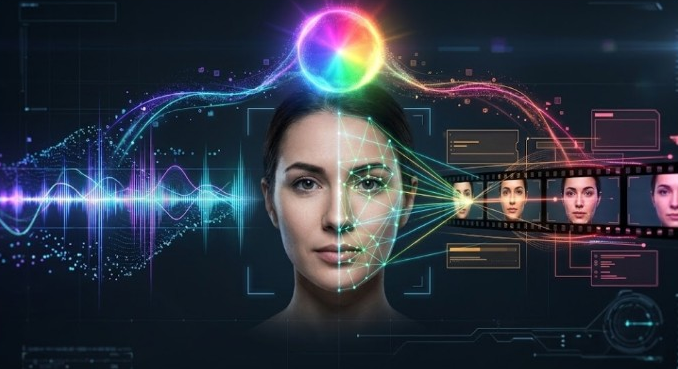
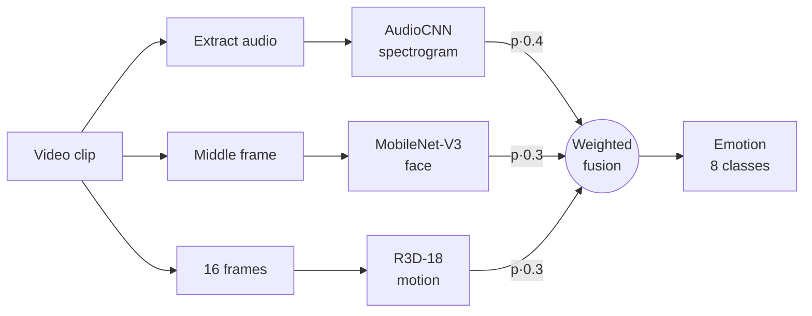

<div align="center">



# 🎭 Emotion Multimodal Hybrid

### One video clip, three models — voice, face and motion fused into a single emotion prediction

      

[](LICENSE)    

[](https://codespaces.new/shiroonigami23-ui/emotion-multimodal-hybrid-app?quickstart=1) [](https://github.com/shiroonigami23-ui/emotion-multimodal-hybrid-app/archive/refs/heads/main.zip)

[**🚀 Live Demo**](https://huggingface.co/spaces/ShiroOnigami23/emotion-multimodal-app) · [**Overview**](#-overview) · [**Features**](#-features) · [**Architecture**](#-architecture) · [**Getting Started**](#-getting-started) · [**Roadmap**](#-roadmap)

</div>

---

## 📖 Overview

This project detects emotion from a **single video clip** by combining three independent models:

1. **Audio** — the soundtrack is extracted and classified by a CNN over spectrograms;
2. **Face** — a key frame is extracted and classified by **MobileNet-V3-Small**;
3. **Motion** — a 16-frame sequence is classified by a **3D-ResNet-18 (R3D-18)**.

Their probabilities are **late-fused** with configurable weights (default audio 0.4, face 0.3, video 0.3) into one of
eight emotions: `angry, calm, disgust, fear, happy, neutral, sad, surprise`. Training runs on Kaggle GPUs over RAVDESS
(speech + video), CREMA-D and FER2013; the weights are published to Hugging Face and served by a **Streamlit Space**
and a native **Android** app.

### ✨ Highlights

- **Three modalities, one clip** — audio, face and temporal video branches
- **Weighted late fusion** configured in `fusion_config.json`
- **Live demo** on [Hugging Face Spaces](https://huggingface.co/spaces/ShiroOnigami23/emotion-multimodal-app) · [model](https://huggingface.co/ShiroOnigami23/emotion-multimodal-engine)
- **Automation scripts** for Kaggle training, GPU-retry, HF upload, Space publish and APK release

## 🧩 Features

| Feature | What it does |
|---|---|
| **Audio branch** | `AudioCNN` — 3 conv blocks over log-mel spectrograms |
| **Face branch** | MobileNet-V3-Small fine-tuned on FER2013 (numeric labels mapped to classes) |
| **Video branch** | R3D-18 over 16 sampled frames (RAVDESS video) |
| **Fusion engine** | `MultiModalEmotionEngine.predict` — weighted sum of branch probabilities |
| **Streamlit app** | `app.py` downloads artefacts from the HF model repo and runs inference |
| **Kaggle pipeline** | `kaggle_kernel/train_multimodal.py` + start/check/wait/relaunch scripts |
| **Android app** | `android_app/` (Kotlin) with release workflow |
| **Publishing** | `upload_to_hf.py`, `publish_space.py`, `upload_apk_release.py` |

## 🛠 Tech Stack

| Layer | Technology |
|---|---|
| Modelling | PyTorch, torchvision (MobileNet-V3, R3D-18), torchaudio |
| Data | RAVDESS speech + video, CREMA-D, FER2013 |
| Training | Kaggle GPU kernels |
| Serving | Streamlit on Hugging Face Spaces |
| Mobile | Android (Kotlin, Gradle KTS) |
| CI | GitHub Actions — Android release, Space publish |

## 🏗 Architecture

Each modality is a separate model; fusion happens at the probability level, so any branch can be missing.



➡️ Full design notes, data flow and design decisions: **[docs/ARCHITECTURE.md](docs/ARCHITECTURE.md)**

## 📁 Project Structure

```text
emotion-multimodal-hybrid-app/
├── src/mmemotion/        # models.py, infer.py, data_utils.py
├── app.py                # Streamlit app
├── kaggle_kernel/        # train_multimodal.py + kernel-metadata.json
├── train_multimodal_allinone.py
├── scripts/              # Kaggle, HF, Space and APK automation
├── android_app/          # Kotlin Android client
└── assets/               # icons
```

## 🚀 Getting Started

### Prerequisites

- Python 3.10+, ffmpeg
- Optional: Kaggle API + Hugging Face token for training/publishing

### 1. Get the code

Pick whichever method suits you:

| Method | Command |
|---|---|
| **HTTPS** | `git clone https://github.com/shiroonigami23-ui/emotion-multimodal-hybrid-app.git` |
| **SSH** | `git clone git@github.com:shiroonigami23-ui/emotion-multimodal-hybrid-app.git` |
| **GitHub CLI** | `gh repo clone shiroonigami23-ui/emotion-multimodal-hybrid-app` |
| **ZIP** | [Download](https://github.com/shiroonigami23-ui/emotion-multimodal-hybrid-app/archive/refs/heads/main.zip) and extract |
| **Codespaces** | [Open in browser](https://codespaces.new/shiroonigami23-ui/emotion-multimodal-hybrid-app?quickstart=1) — zero local setup, dev container preconfigured |

> 🔑 **Using SSH for the first time?** Generate a key with `ssh-keygen -t ed25519 -C "you@example.com"`, add the `.pub` contents at **GitHub → Settings → SSH and GPG keys**, then test with `ssh -T git@github.com`.

### 2. Install & set up

```bash
cd emotion-multimodal-hybrid-app
pip install -r requirements.txt
```

### 3. Run

```bash
streamlit run app.py                                     # local app (downloads weights from HF)
python scripts/start_kaggle_training.py --owner <kaggle-user>
python scripts/check_kaggle_status.py --owner <kaggle-user>
python scripts/upload_to_hf.py --model-repo-id <user>/emotion-multimodal-engine --outputs-dir kaggle_pull
```

## 🎮 Usage

Upload a short clip of a person speaking. The app shows per-branch probabilities and the fused result. You can also
upload just audio or just an image — missing branches are skipped and the remaining weights are used.

Training outputs: `audio_model.pt`, `face_model.pt`, `video_model.pt`, `fusion_config.json`, `metrics.json`, `run_version.json`.

## 🗺 Roadmap

**v1 — Hybrid engine (done)**

- [x] Audio, face and video branches
- [x] Weighted late fusion
- [x] Kaggle training automation, HF model + Space, Android app

**v1.1 — Accuracy**

- [ ] Learned fusion head / attention over branch embeddings
- [ ] Per-dataset and per-class metrics published in the README
- [ ] Face detection + alignment before the face branch

**v1.2 — Real-time**

- [ ] Webcam + microphone streaming mode
- [ ] On-device TFLite/ONNX models for the Android app

**v2.0**

- [ ] Text branch (speech-to-text + sentiment) for a fourth modality
- [ ] Bias and fairness evaluation across demographics

➡️ Detailed plan, milestones and long-term vision: **[docs/ROADMAP.md](docs/ROADMAP.md)**

## 🤝 Contributing

Contributions, issues and feature requests are welcome!

1. Fork the repository
2. Create a feature branch: `git checkout -b feature/amazing-feature`
3. Commit your changes: `git commit -m "feat: add amazing feature"`
4. Push the branch: `git push origin feature/amazing-feature`
5. Open a Pull Request against `main`

Check the [issues page](https://github.com/shiroonigami23-ui/emotion-multimodal-hybrid-app/issues) and the [roadmap](docs/ROADMAP.md) for ideas on where to help.

## 📜 Changelog

See [CHANGELOG.md](CHANGELOG.md) for the release history.

## 📄 License

Distributed under the **MIT** license. See [LICENSE](LICENSE) for details.

## 👤 Author

**Aryan Singh Chandel** (Shiro)

[](https://github.com/shiroonigami23-ui)

<div align="center">

⭐ **If you find this project useful, consider giving it a star!** ⭐

</div>
