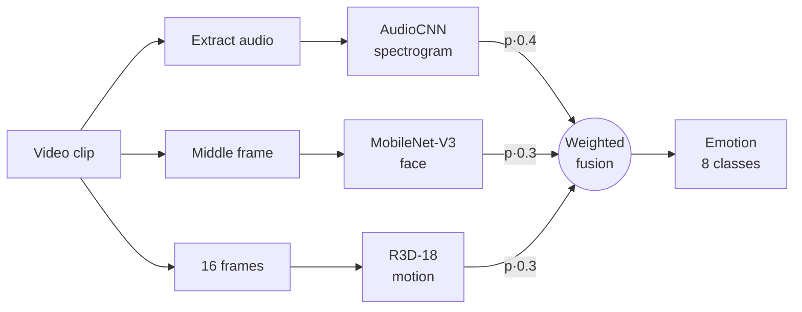

# 🏗 Architecture — Emotion Multimodal Hybrid

> Part of [emotion-multimodal-hybrid-app](https://github.com/shiroonigami23-ui/emotion-multimodal-hybrid-app). Back to the [README](../README.md).

## 1. System Overview

`MultiModalEmotionEngine` loads three independently trained models and a fusion config. For a video, it extracts the
audio track and middle frame, samples 16 frames, runs each branch, multiplies each softmax by its weight and sums them.

## 2. Components

| Component | Location | Responsibility |
|---|---|---|
| **Models** | `src/mmemotion/models.py` | AudioCNN, MobileNet-V3 face model, R3D-18 video model |
| **Inference** | `src/mmemotion/infer.py` | Branch logits, frame/audio extraction, fusion |
| **Data utils** | `src/mmemotion/data_utils.py` | Label maps, preprocessing |
| **App** | `app.py` | Streamlit UI + HF artefact download |
| **Training** | `kaggle_kernel/train_multimodal.py` | Trains all three branches on Kaggle |

## 3. Data / Control Flow

1. The user uploads media; the app fetches artefacts from the HF model repo.
2. Audio is extracted with ffmpeg and turned into a spectrogram; a middle frame and 16 frames are sampled.
3. Each branch outputs class probabilities; weights from `fusion_config.json` are applied.
4. The weighted sum's argmax is the final emotion.

## 4. Key Design Decisions

| Decision | Rationale |
|---|---|
| Late fusion | Branches can be trained on different datasets and work independently |
| Lightweight backbones | MobileNet-V3 and R3D-18 keep CPU inference feasible |
| Kaggle + HF | Free GPUs for training, free hosting for serving |

## 5. Known Limitations

- Fusion weights are fixed, not learned
- Trained on acted datasets; real-world speech may differ

---
*Last updated: 2026-11-13*
